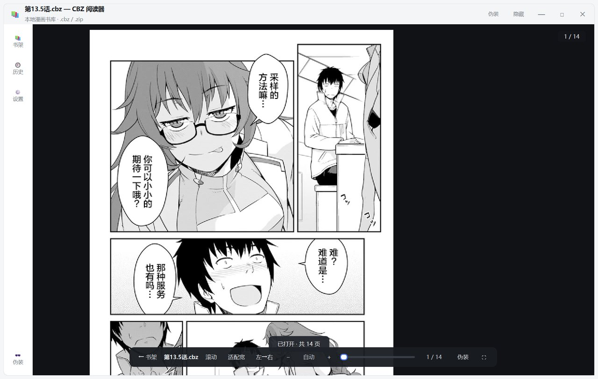
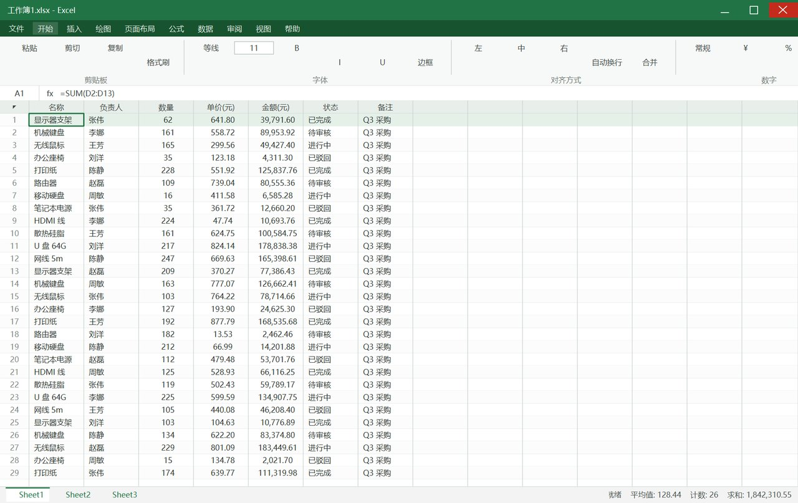
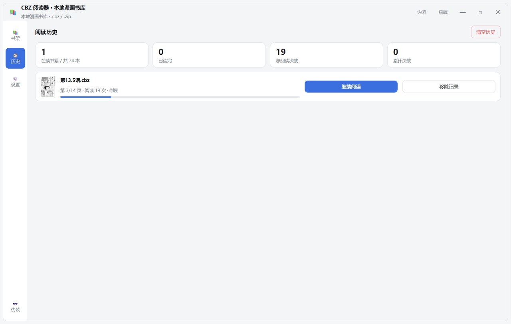
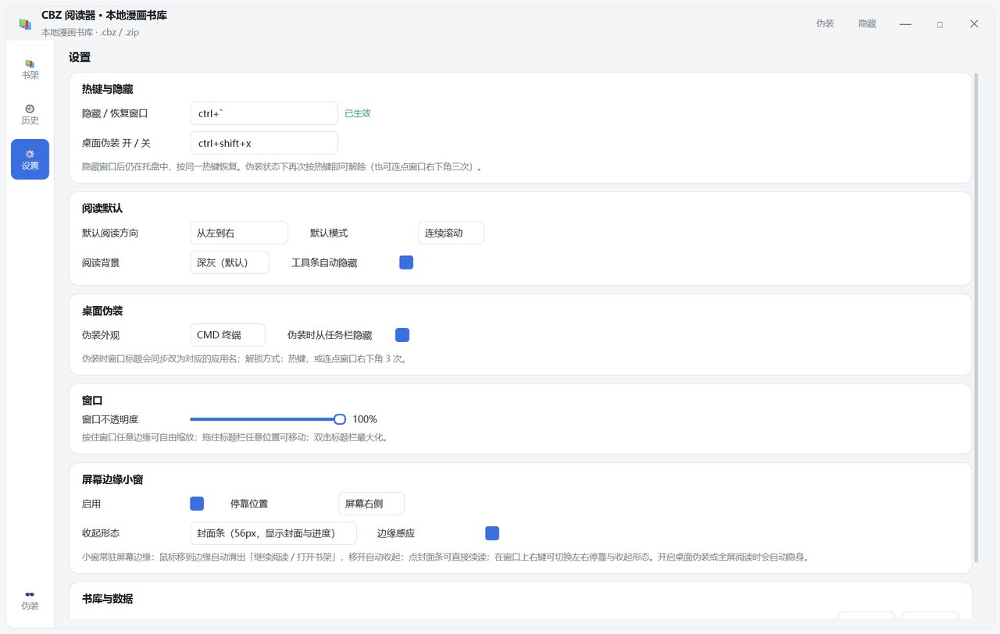

# CBZ 阅读器

Windows 11 桌面漫画阅读器 —— 书架、历史记录、批量导入、无边框自由拖动缩放、全局热键隐藏、桌面伪装、屏幕边缘小窗。

基于 **Python 3.13 + PySide6** 开发，读取 `.cbz / .zip` 漫画压缩包（内页支持 jpg / png / webp）。

## 界面预览

| 书架（封面墙 + 进度角标） | 阅读器（连续滚动 / 单页） | 桌面伪装（Excel / Word / CMD） |
|---|---|---|
|  |  |  |

| 历史记录 + 统计 | 设置 | 屏幕边缘小窗 |
|---|---|---|
|  |  |  |

---

## 功能一览

| 功能 | 说明 |
|---|---|
| **书架** | 封面墙（异步生成 + 磁盘缓存）、关键词搜索、4 种排序、已读角标与进度条、右键菜单（继续阅读 / 标记已读 / 在文件夹中显示 / 移入回收站） |
| **历史记录** | 每本记录页码、滚动位置、阅读次数与时间；顶部「继续阅读」快捷卡片；统计卡（在读书籍 / 已读完 / 阅读次数 / 累计页数） |
| **批量导入** | 选文件、选文件夹（递归扫描）、拖拽进窗口；**复制入库** 或 **仅登记引用**（不复制文件，适合已有的整理好的大目录），支持同名跳过 / 覆盖 / 重命名 |
| **阅读器** | 连续滚动 / 单页翻页、适配宽/高/原始、Ctrl+滚轮缩放、拖拽平移、左→右 / 右→左（日漫）、全屏、工具条自动隐藏、进度自动续读、异步解码 + LRU 缓存 |
| **窗口** | 无边框自绘：拖标题栏移动、四边四角八向缩放、双击最大化、几何位置记忆、可调不透明度 |
| **全局热键** | 任意界面下隐藏 / 恢复窗口（默认 `Ctrl+\``），托盘图标常驻 |
| **桌面伪装** | 一键把窗口变成 Excel 表格 / Word 文档 / CMD 终端（自绘假界面 + 假数据），窗口标题同步伪装，可同时从任务栏隐藏 |
| **屏幕边缘小窗** | 常驻屏幕边缘的迷你窗：鼠标碰边滑出「继续阅读 / 打开书架 / 最近在读」，离开自动收起；支持左/右停靠、封面条(56px)/细缝(8px) 两种收起形态；伪装与全屏时自动隐身 |

## 运行

**方式一：直接运行源码**

```bash
pip install PySide6 Pillow
python main.py
```

Windows 下双击 `启动阅读器.bat`（无控制台窗口），排错时用 `调试启动.bat`（保留控制台输出）。

**方式二：安装包**

下载 `CBZReader_Setup_1.0.0.exe`，双击安装（安装到 `%LOCALAPPDATA%\CBZReader`，无需管理员权限），自动创建桌面与开始菜单快捷方式，可在「设置 → 应用」中卸载。
便携版 `CBZReader_1.0.0_portable.zip` 解压即用。

## 快捷键

**全局热键**（窗口隐藏、失焦时同样有效）

| 热键 | 作用 |
|---|---|
| `Ctrl` + `` ` `` | 隐藏 / 恢复窗口 |
| `Ctrl` + `Shift` + `X` | 进入 / 退出桌面伪装（也可连点窗口右下角 3 次解锁） |

**阅读器内**

| 键 | 作用 |
|---|---|
| `←/→`、`A/D` | 翻页（右→左方向自动反向） |
| `↑/↓`、`J/K` | 滚动 |
| `空格` / `PgDn` / `PgUp` | 翻一屏 |
| `Home` / `End` | 首页 / 末页 |
| `+` / `-` / `0` | 放大 / 缩小 / 恢复适配宽度 |
| `Ctrl` + 滚轮 | 缩放 |
| `M` / 双击页面 | 连续滚动 ↔ 单页翻页 |
| `R` | 切换阅读方向 |
| `Esc` | 返回书架 |
| `F11` | 全屏 |

**窗口**：`Alt+1/2/3` 切换书架 / 历史 / 设置，`Ctrl+F` 搜索，双击标题栏最大化。

## 目录结构

```
cbz-reader/
├── main.py                 入口（单实例守卫、DPI、主题）
├── app/
│   ├── store.py            配置 / 书架 / 历史（JSON 原子写）
│   ├── cbr.py              CBZ 解析：自然排序、页尺寸缓存、封面缓存
│   ├── tasks.py            QThreadPool 异步：封面、解码、导入
│   ├── hotkey.py           Win32 RegisterHotKey 全局热键
│   ├── window.py           无边框窗口基类（拖动 / 八向缩放 / 最大化）
│   ├── shelf.py            书架页（FlowLayout 封面墙）
│   ├── reader.py           阅读器（自绘滚动 / 单页）
│   ├── edge.py             屏幕边缘小窗
│   ├── camo.py             桌面伪装（Excel / Word / CMD 皮肤）
│   ├── pages.py            历史页 + 设置页
│   ├── main_window.py      主窗口整合、托盘、导入流程
│   ├── theme.py            配色与 QSS
│   └── imgutil.py          Pillow → QImage
├── tools/
│   ├── smoke_test.py       无头回归测试（31 项断言）
│   ├── render_preview.py   真机截图预览
│   └── make_icon.py        生成 assets/icon.ico 与 PNG
├── packaging/
│   ├── build.py            一键打包脚本
│   ├── selfinstall.py      单文件安装程序（自解包 → 调用安装脚本）
│   ├── install.ps1         安装逻辑：复制文件 / 建快捷方式 / 注册卸载信息
│   └── uninstall.ps1       卸载逻辑
├── docs/screenshots/       README 截图
├── 启动阅读器.bat / 调试启动.bat
└── requirements.txt
```

运行时数据写在程序同级目录：`data/`（config / shelf / history）、`cache/`（封面、页尺寸、预览图）。

## 测试

```bash
python tools/smoke_test.py     # 无头回归：导入 / 封面 / 解码 / 翻页 / 缩放 / 伪装 / 热键 / 边缘小窗 / 拖动缩放
python tools/render_preview.py # 真机渲染截图（输出到 cache/_preview/）
```

> 注意：无头（offscreen）模式无法渲染文字，判断字体与排版请使用 `render_preview.py`。

## 打包

```bash
python -m pip install pyinstaller
python packaging/build.py      # 图标 → PyInstaller → 冻结自检 → 便携 zip → 单文件安装包
```

产物：

| 文件 | 说明 |
|---|---|
| `dist/CBZReader/` | 绿色版程序目录（123 MB，含 Qt 运行时） |
| `dist/CBZReader_1.0.0_portable.zip` | 便携版压缩包（约 51 MB） |
| `dist/CBZReader_Setup_1.0.0.exe` | 单文件安装包（自带负载，双击即装，无需管理员） |

打包流程内置 `CBZReader.exe --selftest` 自检：验证 Pillow/WebP 解码、目录可写、书架读取与封面生成，自检不通过则打包失败。

## 已知限制

- 仅支持 `.cbz / .zip`，`.cbr`（RAR 压缩）需要额外的解压库，暂未纳入
- 首次打开一本较大的漫画时会建立页尺寸缓存，可能有一瞬间的停顿（之后走缓存）
- 删除文件走系统回收站，不使用永久删除
