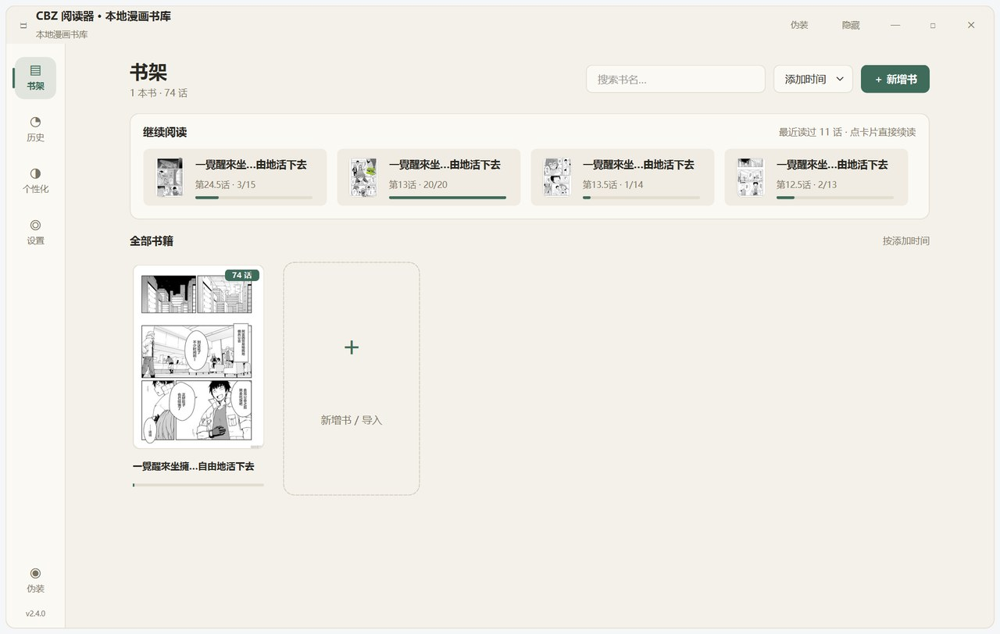
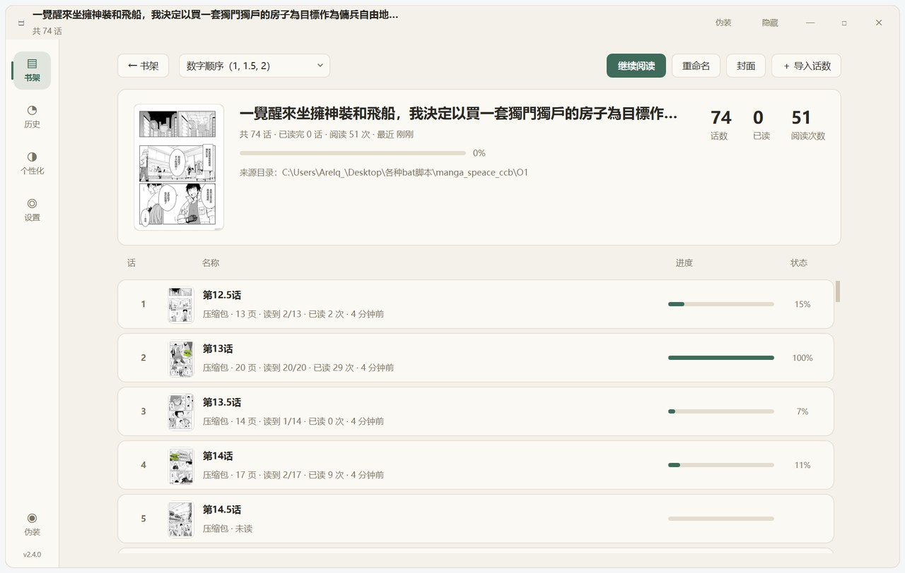
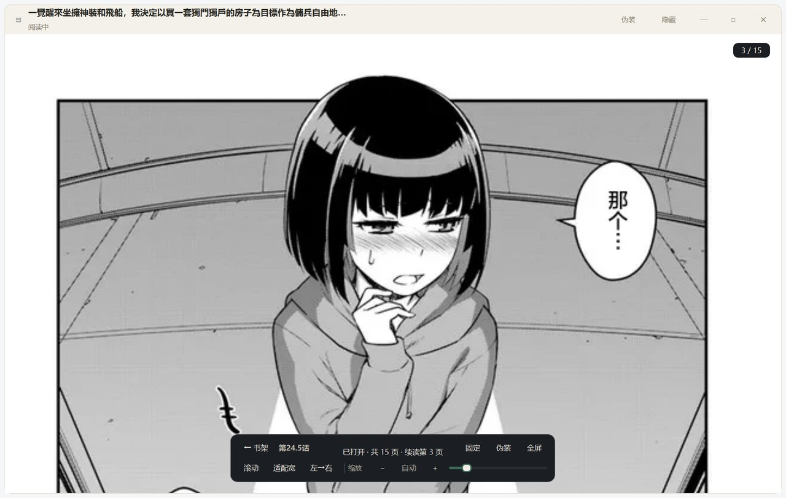
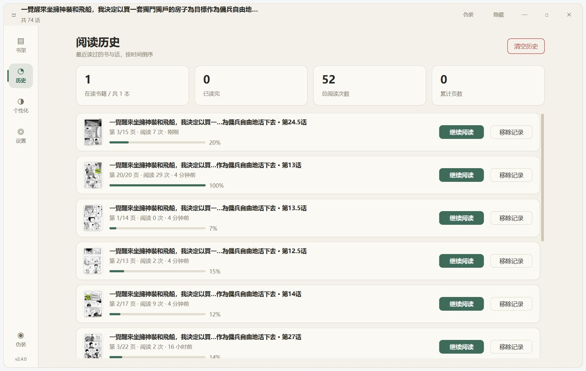
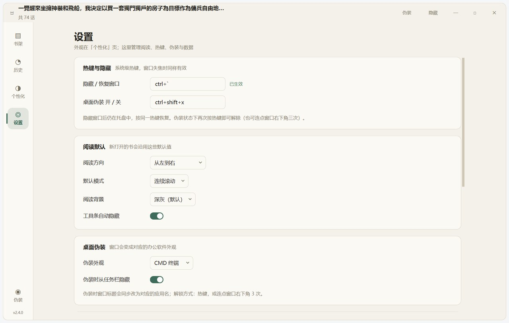
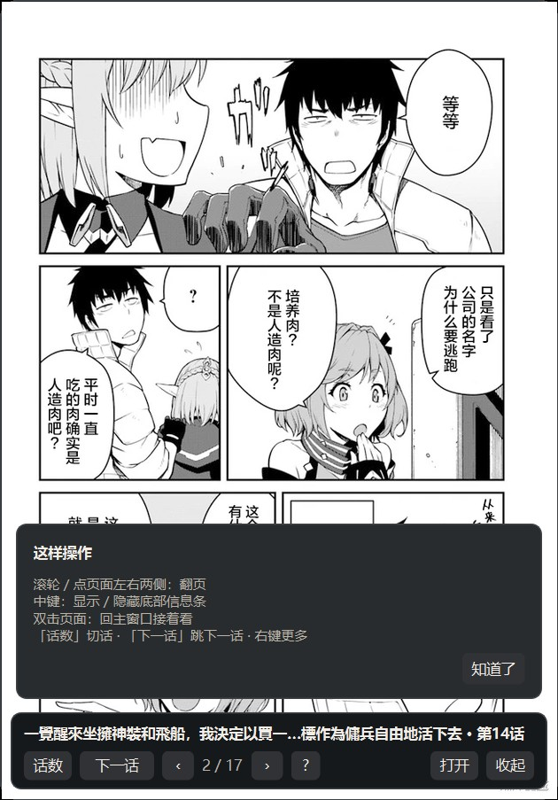
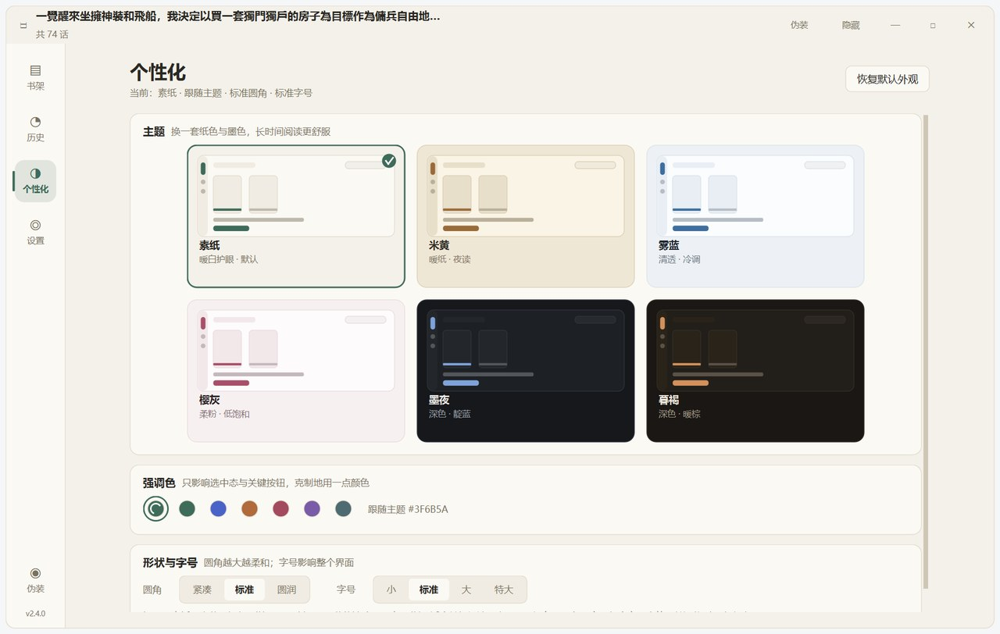
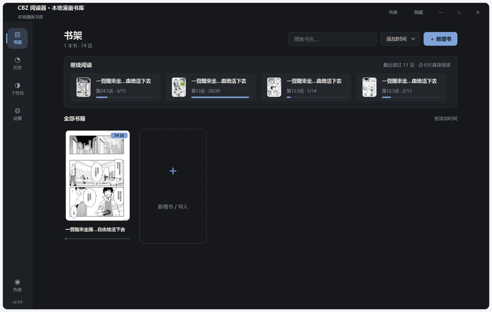

# CBZ 阅读器

Windows 11 桌面漫画阅读器 —— **两层书架（书 → 话）**、阅读进度、无边框自由拖动缩放、全局热键隐藏、桌面伪装、屏幕边缘小窗，以及**可切换的多主题个性化外观**（护眼纸色 / 雾蓝 / 樱灰 / 夜色）。

基于 **Python 3.13 + PySide6** 开发。一话可以是 `.cbz / .zip` 压缩包，也可以是**装满图片的文件夹**（内页支持 jpg / png / webp / bmp / gif）。

## 界面预览

| 书架（书封面墙） | 书详情（一本书的各话） | 阅读器（连续滚动 / 单页） |
|---|---|---|
|  |  |  |

| 阅读历史 | 设置 | 桌面伪装（Excel / Word / CMD） | 边缘迷你阅读器 |
|---|---|---|---|
|  |  |  |  |

| 边缘小窗：中键唤出信息条 | 首次操作提示 |
|---|---|
|  |  |

| 个性化（主题画廊 / 强调色 / 圆角 / 字号） | 深色主题「墨夜」 |
|---|---|
|  |  |

## 使用流程

```
① 书架点「＋ 新增书」→ 输入书名（或直接把 .cbz / 文件夹拖进窗口自动建书）
② 进入书详情 → 「＋ 导入话数」选文件或文件夹 → 各话按名称自然排序（第2话 < 第10话）
③ 点任意一话开始阅读；退出后书架/书详情都会显示进度，点「继续阅读」自动续读
```

一本书 = 一部漫画；一话 = 一个 cbz/zip 或一个图片文件夹。导入时可选**复制入库**（搬进书库目录）或**仅登记引用**（不动原文件）。

## 功能一览

| 功能 | 说明 |
|---|---|
| **个性化** | 4 个维度、全部实时生效并记住：**6 套主题**（素纸 / 米黄 / 雾蓝 / 樱灰 / 墨夜 / 暮褐）× **7 种强调色**（含「跟随主题」）× **3 档圆角**（紧凑 / 标准 / 圆润）× **4 档字号**（小 / 标准 / 大 / 特大）。主题卡直接按该主题真实配色绘制迷你界面，点一下即换 |
| **书架（书）** | 以「书」为单位的封面墙：书名、话数角标、已读进度条；搜索、按添加时间/书名/最近阅读/话数排序；右键可重命名、设置封面（自动取首话 / 指定某一话 / 自定义图片）、导入话数、在文件夹中显示、移除 |
| **书详情（话）** | 封面 + 书名 + 统计（话数 / 已读 / 阅读次数 / 最近阅读）+ 总进度；各话列表显示类型、页数、进度条、百分比与最近阅读时间；支持重命名、标记已读/未读、用作封面、移出这本书、删除文件（回收站）。**话数排列可按书单独选择**（详见下节） |
| **继续阅读** | 书架与书详情都能一键续读；边缘小窗、托盘同样可续读 |
| **批量导入** | 选文件 / 选文件夹（自动识别：文件夹含图片=一话，含多个 cbz 或子文件夹=多话）/ 拖拽导入；同名支持跳过 / 覆盖 / 重命名 |
| **阅读器** | 连续滚动 / 单页翻页、适配宽/高/原始、Ctrl+滚轮缩放、拖拽平移、左→右 / 右→左（日漫）、全屏、进度自动续读、异步解码 + LRU 缓存。**页面零边距**：图片多宽就铺多宽，逐页按自身比例缩放，无多余留白。**工具条两行分组**（导航 / 模式 / 缩放 / 页码 / 动作），可「固定」不自动隐藏；隐藏后底部常驻「⌃ 工具栏」把手，点一下即可唤出 |
| **窗口** | 无边框自绘：拖标题栏移动、四边四角八向缩放、双击最大化、几何位置记忆、可调不透明度；**关闭窗口时可选「每次询问 / 关闭软件 / 最小化到托盘」**，询问时可勾选记住。注意区分：**关闭窗口→托盘**时边缘迷你阅读器继续保留；**老板键 `Ctrl+`** 隐藏时连小窗一起藏 |
| **全局热键** | 任意界面下隐藏 / 恢复窗口（默认 `Ctrl+\``），托盘图标常驻 |
| **桌面伪装** | 一键把窗口变成 Excel 表格 / Word 文档 / CMD 终端（自绘假界面 + 假数据），窗口标题同步伪装，可同时从任务栏隐藏 |
| **边缘迷你阅读器** | 藏在屏幕边缘的隐蔽式小阅读器：平时只是一条 6px 细缝，鼠标碰到屏幕边缘即滑出当前页；**滚轮 / 点左右两侧直接翻页**、**Ctrl+滚轮调整阅读窗大小**、**展开时信息条默认隐藏**（页面完整可见），**点按鼠标中键**显示 / 隐藏底部信息条（右键菜单同效），首次展开会显示「这样操作」提示卡，「?」可随时再看；**底部「话数」按钮可直接切换话数**（深色列表、当前话高亮）；**翻到末页继续翻会自动进入下一话**，此时按钮变为「下一话」（首页则变为「上一话」）；**窗口高度自动贴合图片比例**（宽幅页不留黑边）；鼠标离开**立即**缩回；进度实时写回书架；双击页面在主窗口打开当前页。主窗口隐藏（`Ctrl+\``）、桌面伪装、全屏阅读时自动一起隐身 |
| **旧数据迁移** | 旧版扁平书架首次启动自动按目录归并成「书」，阅读历史不丢失 |

## 话数排列

不同来源的命名习惯差别很大，默认**完全按导入时的文件顺序**，不做任何重排；需要时可在书详情页左上角的下拉框里，为**这一本书**单独选择排列方式：

| 模式 | 效果 | 适合 |
|---|---|---|
| **默认（导入顺序）** | 保持导入时的先后，不重排 | 文件名本身有序，或想完全自己掌控 |
| **数字顺序** | `1, 1.5, 2, 2.5, 3, 3.1, 3.2` | 有小数话、想看严格数值顺序 |
| **小节前置** | `1, 2, 3.1, 3.2, 3, 4` | 3.1 / 3.2 是第 3 话的番外，却排在 3 前面 |
| **上下篇** | `1上, 1下, 1` | 同一话拆成上/中/下（前/中/后） |

设置写在 `books.json` 里，按书记忆；导入新话后仍按当前模式显示，小窗的「下一话」也跟着这个顺序走。

## 排版与图标

- 内容区不再铺满整窗：最大 **1280px 版心居中**，宽屏不散、窄屏自动收窄
- 正文 13px、说明 12px、页面标题 24px，设置页改为「标签列 + 控件列」的栅格对齐
- 书架：继续阅读卡片按宽度自动换行，末尾固定一个「新增书 / 导入」占位卡
- 全部界面图标改为几何字形，**不使用彩色 emoji**

## 主题与护眼

界面按「低刺激纸感」重做：背景不用纯白纯黑，正文与背景的对比够用但不刺眼，强调色只出现在当前态与关键动作上。

| 主题 | 观感 | 适合 |
|---|---|---|
| **素纸**（默认） | 暖白纸 + 松绿 | 白天长时间阅读，默认推荐 |
| **米黄** | 更暖的旧纸 + 赭石 | 夜间暖光环境、眼睛容易累 |
| **雾蓝** | 冷调浅灰蓝 + 靛蓝 | 喜欢清爽通透的观感 |
| **樱灰** | 柔粉灰 + 绛红 | 想要一点颜色但不吵 |
| **墨夜** | 近黑 + 靛蓝 | 关灯阅读 |
| **暮褐** | 深棕黑 + 琥珀 | 关灯但不想太冷 |

强调色、圆角、字号可以在同一页继续调，互不冲突；所有选择写入 `data/config.json`，下次启动保持。阅读器自身的背景色仍在「设置 → 阅读默认」里单独设置（深灰 / 纯黑 / 墨蓝 / 暖白 / 米黄）。

## 运行

**方式一：直接运行源码**

```bash
pip install PySide6 Pillow
python main.py
```

Windows 下双击 `启动阅读器.bat`（无控制台窗口），排错时用 `调试启动.bat`（保留控制台输出）。

**方式二：安装包**

下载 `CBZReader_Setup_2.4.0.exe`，双击安装（安装到 `%LOCALAPPDATA%\CBZReader`，无需管理员权限），自动创建桌面与开始菜单快捷方式，可在「设置 → 应用」中卸载。
便携版 `CBZReader_2.4.0_portable.zip` 解压即用。

## 快捷键

**全局热键**（窗口隐藏、失焦时同样有效）

| 热键 | 作用 |
|---|---|
| `Ctrl` + `` ` `` | 隐藏 / 恢复窗口 |
| `Ctrl` + `Shift` + `X` | 进入 / 退出桌面伪装（也可连点窗口右下角 3 次解锁） |

**阅读器内**

| 键 | 作用 |
|---|---|
| `←/→`、`A/D` | 翻页（右→左方向自动反向） |
| `↑/↓`、`J/K` | 滚动 |
| `空格` / `PgDn` / `PgUp` | 翻一屏 |
| `Home` / `End` | 首页 / 末页 |
| `+` / `-` / `0` | 放大 / 缩小 / 恢复适配宽度 |
| `Ctrl` + 滚轮 | 缩放 |
| `M` / 双击页面 | 连续滚动 ↔ 单页翻页 |
| `R` | 切换阅读方向 |
| `Esc` | 返回书详情（没有所属书时返回书架） |
| `F11` | 全屏 |

**窗口**：`Alt+1/2/3/4` 切换书架 / 历史 / 个性化 / 设置，`Ctrl+F` 搜索，双击标题栏最大化。

**阅读器工具条**：鼠标移动即出现；点「固定」后常驻。工具条隐藏时，底部中央的「⌃ 工具栏」把手可随时唤出。

**边缘迷你阅读器**：鼠标碰到屏幕边缘自动滑出 → `滚轮` 或点页面左右两侧翻页 → `Ctrl+滚轮` 调整阅读窗大小（280–760px，自动记忆）→ 鼠标离开立即缩回；双击页面在主窗口打开当前页（主窗口在托盘里也会一并唤回）；小窗上右键可切换停靠边 / 细缝或窄条 / 边缘感应；底部「话数」按钮可切换同书的其他话。

**隐藏行为的区别**：点 ✕ 选「最小化到托盘」只是收走主窗口，边缘迷你阅读器**保留可用**；用老板键 `Ctrl+` 或标题栏隐藏按钮时，主窗口与小窗**一起隐藏**，适合有人靠近时一键全藏。

## 目录结构

```
cbz-reader/
├── main.py                 入口（单实例守卫、DPI、主题、--selftest 自检）
├── app/
│   ├── store.py            数据层：配置 + 书库(books/chapters) + 历史 + 旧数据迁移
│   ├── cbr.py              话解析：压缩包 / 图片文件夹统一读取 + 导入扫描
│   ├── tasks.py            QThreadPool 异步：封面、解码、导入
│   ├── hotkey.py           Win32 RegisterHotKey 全局热键
│   ├── window.py           无边框窗口基类（拖动 / 八向缩放 / 最大化）
│   ├── shelf.py            书架页（书的封面墙 + 继续阅读）
│   ├── book.py             书详情页（各话列表 + 阅读进度）
│   ├── reader.py           阅读器（自绘滚动 / 单页）
│   ├── edge.py             边缘迷你阅读器（贴边隐蔽式小阅读窗）
│   ├── camo.py             桌面伪装（Excel / Word / CMD 皮肤）
│   ├── pages.py            历史页 + 设置页
│   ├── personalize.py      个性化页（主题画廊 / 强调色 / 圆角 / 字号）
│   ├── dialogs.py          通用输入对话框
│   ├── main_window.py      主窗口整合、导航、托盘、导入流程
│   ├── theme.py            主题引擎（6 套主题 × 强调色 × 圆角 × 字号 → QSS token）
│   └── imgutil.py          Pillow → QImage
├── tools/
│   ├── smoke_test.py       无头回归测试（74 项断言）
│   ├── render_preview.py   真机截图预览
│   └── make_icon.py        生成 assets/icon.ico 与 PNG
├── packaging/
│   ├── build.py            一键打包脚本
│   ├── selfinstall.py      单文件安装程序（自解包 → 调用安装脚本）
│   ├── install.ps1         安装逻辑：复制文件 / 建快捷方式 / 注册卸载信息
│   └── uninstall.ps1       卸载逻辑
├── docs/screenshots/       README 截图
├── 启动阅读器.bat / 调试启动.bat
└── requirements.txt
```

运行时数据写在程序同级目录：`data/`（config / books / history）、`cache/`（封面、页尺寸、书封面、预览图）。

## 测试

```bash
python tools/smoke_test.py     # 无头回归（书→话模型 / 导入 / 解码 / 翻页 / 伪装 / 热键 / 边缘小窗 / 个性化主题 / 拖动缩放）
python tools/render_preview.py # 真机渲染截图（输出到 cache/_preview/）
```

> 注意：无头（offscreen）模式无法渲染文字，判断字体与排版请使用 `render_preview.py`。

## 打包

```bash
python -m pip install pyinstaller
python packaging/build.py      # 图标 → PyInstaller → 冻结自检 → 便携 zip → 单文件安装包
```

产物：

| 文件 | 说明 |
|---|---|
| `dist/CBZReader/` | 绿色版程序目录（约 123 MB，含 Qt 运行时） |
| `dist/CBZReader_2.4.0_portable.zip` | 便携版压缩包（约 62 MB） |
| `dist/CBZReader_Setup_2.4.0.exe` | 单文件安装包（自带负载，双击即装，无需管理员） |

打包流程内置 `CBZReader.exe --selftest` 自检：验证 Pillow/WebP 解码、目录可写、书库读取与封面生成，自检不通过则打包失败。

## 已知限制

- 支持 `.cbz / .zip / 图片文件夹`；`.cbr`（RAR 压缩）需要额外的解压库，暂未纳入
- 首次打开一本较大的漫画时会建立页尺寸缓存，可能有一瞬间的停顿（之后走缓存）
- 删除走系统回收站，不使用永久删除；移除书/话只删记录，不动磁盘文件
- **清晰度**：解码按「屏幕物理像素」出图（支持 125% / 150% 缩放的高 DPI 屏），并会校验缓存尺寸、自动重解过期的小图；但原图本身分辨率过低时（例如 650px 宽的压缩页）放大显示仍会偏软，这是源文件限制
